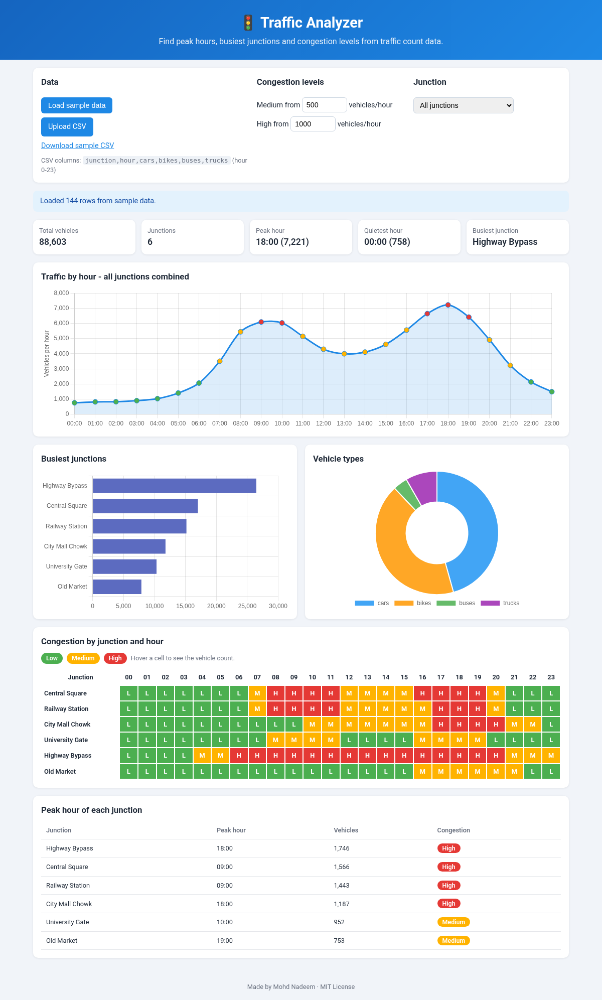
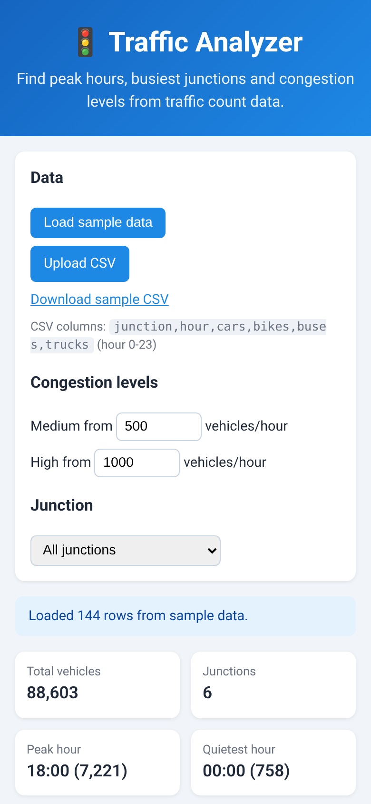

# Traffic Analyzer

A small **static web app** (HTML, CSS, vanilla JavaScript) that analyses traffic count data.
Load the built-in sample data or upload your own CSV and instantly see **peak hours**,
**busiest junctions** and the **congestion level** (low / medium / high) of every junction for every hour.

> Built as a 3rd-year B.Tech mini project to practise JavaScript, DOM handling, CSV parsing and data visualisation.



<p align="center">
  
</p>

## Features

- 📂 **Sample data included** (6 junctions × 24 hours, 4 vehicle types) - the page opens with it already loaded
- ⬆️ **Upload your own CSV** - bad rows are skipped and explained, a wrong header gives a clear error
- ⏰ **Peak hour** (city-wide or for one junction) and quietest hour
- 🚗 **Busiest junctions** ranking
- 🟢🟡🔴 **Congestion level** per junction and hour as a colour heatmap (thresholds are adjustable)
- 📊 **Charts with Chart.js (CDN):** hourly line chart, junction bar chart, vehicle-type doughnut
- 📱 **Responsive** layout (the heatmap scrolls sideways on phones)
- No build step, no frameworks, no backend - ready for **GitHub Pages**

## How it decides congestion

For each junction and hour the app adds up all vehicle types and compares the total:

| Level  | Vehicles per hour (default) |
|--------|-----------------------------|
| Low    | below 500                   |
| Medium | 500 to 999                  |
| High   | 1000 or more                |

You can change the Medium/High limits in the page.

## CSV format

```csv
junction,hour,cars,bikes,buses,trucks
Central Square,8,640,590,52,70
Central Square,9,702,655,58,81
```

- `junction` - name of the junction
- `hour` - 0 to 23 (`8`, `08` or `08:00` are all fine)
- every other column is treated as a vehicle type with a count (you can use different ones, e.g. only `cars,bikes`)
- if the same junction and hour appears twice, the counts are added together

A ready-made file is in [`data/sample-traffic.csv`](data/sample-traffic.csv).

## How to run

**Option 1 - just open it:** double-click `index.html`. It works directly from the file system
(the sample data is embedded in `data/sample-data.js`, because browsers block `fetch()` on `file://`).
Charts need an internet connection once, to load Chart.js from the CDN.

**Option 2 - local server (optional):**

```bash
python3 -m http.server 8000
# open http://localhost:8000
```

**Option 3 - GitHub Pages:** push the repo, then *Settings → Pages → Deploy from branch → main / (root)*.

### Run the tests (optional, needs Node.js)

```bash
node tests/analysis.test.js
```

## Project structure

```
traffic-analyzer/
├── index.html            # page layout
├── css/style.css         # styling + responsive rules
├── js/
│   ├── csvParser.js      # CSV text -> records (with validation)
│   ├── analysis.js       # peak hours, busiest junctions, congestion (pure functions)
│   ├── charts.js         # Chart.js chart drawing
│   └── app.js            # connects everything to the page
├── data/
│   ├── sample-traffic.csv   # sample data (also downloadable in the app)
│   └── sample-data.js       # same data embedded for file:// use
├── tools/generate_sample.py # script that created the sample data
└── tests/analysis.test.js   # simple Node tests
```

## Possible improvements

- Multi-day data with date filter and averages
- Weighted counts (a bus or truck takes more road space than a bike)
- Export report as PDF / image
- Map view of junctions

## License

MIT - see [LICENSE](LICENSE). Author: Mohd Nadeem
